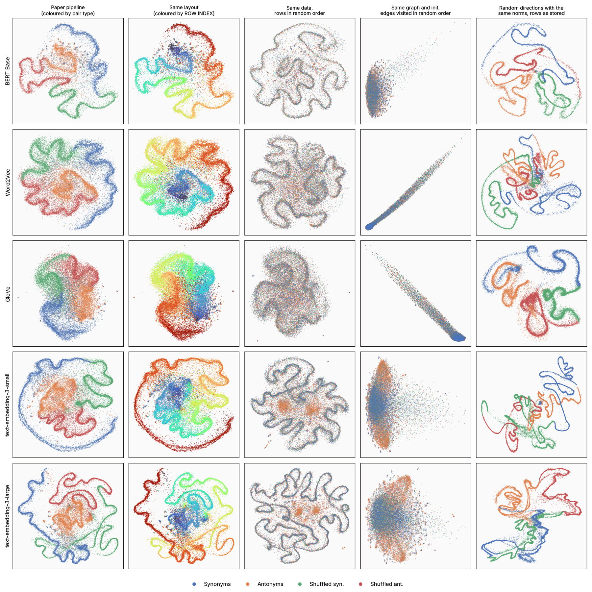
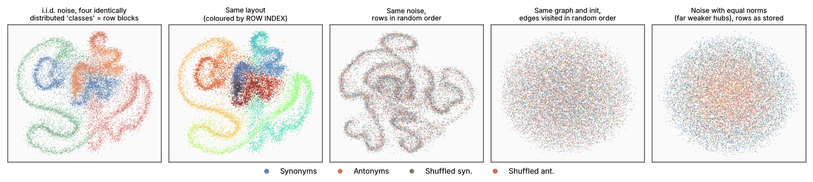
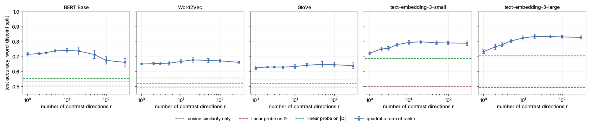

# Is the swirl real? Controls, literature, and what the embeddings do show

This note reviews the preprint in `prose/` (arXiv:2603.24150) against two questions:
is the "swirl" a property of antonym and synonym embeddings or an artefact, and how
should the work be placed in the literature? Everything below can be regenerated with
the scripts listed in [section 6](#6-reproducing-this-note). The paper text itself has
not been touched.

*Provenance: written by an AI coding assistant (Claude) at the author's request. The
experiments are scripted and the numbers come from `data/`; the literature entries
were checked against publisher records by search agents. Treat it as a referee
report to be verified, not as a finished result.*

## Summary

1. **The swirl is an artefact, and a specific one.** The filaments are parametrised by
   the *row index of the data matrix*. umap-learn's standard layout optimiser (0.5.x,
   which the lockfile pins, and still the default in 0.6.0) is a sequential SGD sweep
   over edges sorted by row. The k-nearest-neighbour graph of the difference vectors
   is dominated by a few hub points, and those hubs are dragged through the plane in
   row order, depositing the other points along their path.
2. **The colour separation is the storage order.** The four pair types are stacked as
   four contiguous row blocks, so they occupy four consecutive stretches of the curve.
   Permuting the rows of the same matrix keeps the filament and mixes the four colours
   uniformly along it (2-D neighbour label agreement falls from 0.74–0.89 to 0.26–0.29;
   chance is 0.25).
3. **No semantics is needed.** I.i.d. Gaussian noise with unequal norms, cut into four
   identically distributed row blocks, gives the same picture. So does replacing every
   difference vector by a random direction of the same length.
4. **The transductive classifier reads the row order.** A reconstruction of the
   cluster-and-vote classifier reproduces the paper's accuracies (0.87–0.95 here,
   0.86–0.94 published). With permuted rows it drops to 0.50–0.52 for word2vec, GloVe
   and BERT and to 0.62–0.65 for the OpenAI models, no better than the same vote
   without UMAP. Random directions with the original norms, stored in the original
   order, score 0.80–0.98.
5. **Stability across models and UMAP settings is not evidence here.** Row order and
   hubness are common to every configuration in the paper. The paper's own ablations
   (Euclidean but not cosine, differences but not concatenations, crisper with the
   shuffled pairs, crispest in 3072 dimensions) are the conditions under which hubs
   form.
6. **There is real structure, but it is not in the UMAP plot.** Without any projection,
   and on word-disjoint splits: a linear probe on the difference vector is at chance,
   as the symmetry of the relations forces; cosine similarity barely helps; but a
   single *direction*, used through its square, separates antonym from synonym pairs
   with 0.63–0.73 accuracy. Its two ends read as affirmative versus negated or
   deficient words, and it agrees across model families (rank correlation 0.61–0.76
   on held-out words). This connects directly to an existing literature on antonym
   pairs as semantic axes.

Sections 1–2 give the evidence for points 1–5, section 3 covers point 6, section 4 the
literature, section 5 concrete suggestions for the paper.

---

## 1. What the swirl is

### 1.1 The filament is the row index

The paper pipeline (`scripts/generate_paper_figures.py`) stacks the pair types in
alphabetical order (antonyms, shuffled antonyms, shuffled synonyms, synonyms),
standardises, and calls `umap.UMAP(..., metric="euclidean", random_state=42)`.
Colouring the regenerated layouts by row index instead of pair type shows one
continuous colour gradient along the filaments (second column below). For the shuffled
pairs the row order is the order in which `random.sample` happened to draw them, so it
carries no information about the embeddings at all. Nevertheless two shuffled pairs
that are neighbours in the plot are a median of about 25 rows apart in
text-embedding-3-large, 40 in BERT, 90–150 in text-embedding-3-small and 250–280 in
word2vec, where 4,900–9,200 would be expected for an unrelated ordering (GloVe, the
most diffuse panel: about 1,000 of 9,000).



*Rows: models. Columns: (1) the paper pipeline; (2) the same layout coloured by row
index; (3) the same matrix with its rows randomly permuted before UMAP; (4) the same
neighbour graph, initialisation, loss and seeds as (1), with the edge list shuffled
once before the layout optimisation; (5) every difference vector replaced by a random
direction of the same length, rows in the original order. UMAP parameters as in the
paper's Figure 3 (`n_neighbors=30`, `min_dist=0.1`). In column 4 the hub-dominated
graph simply collapses towards one clump; in the OpenAI rows part of the antonym
(orange) and synonym (blue) mass comes apart, which is the real signal discussed in
section 3.*

**Rank-locality ratio**: median distance in row order between neighbours in the plot,
divided by its value for an unrelated ordering. 1 means the plot ignores the ordering,
0.02 means plot neighbours are file neighbours.

| Model | rows | paper pipeline | rows permuted, against the order UMAP saw | rows permuted, against the original order | edges in random order | norm-matched noise |
|---|---|---|---|---|---|---|
| Word2Vec | 30,406 | 0.028 | 0.027 | 0.97 | 0.92 | 0.002 |
| GloVe | 30,860 | 0.101 | 0.124 | 0.99 | 0.93 | 0.006 |
| BERT Base | 16,868 | 0.015 | 0.012 | 0.95 | 0.93 | 0.003 |
| text-embedding-3-small | 31,264 | 0.020 | 0.024 | 0.89 | 0.84 | 0.002 |
| text-embedding-3-large | 31,264 | 0.005 | 0.005 | 0.90 | 0.83 | 0.003 |
| i.i.d. noise (1.3) | 16,000 | 0.016 | 0.015 | – | 1.00 | – |

**Label agreement**: share of each point's 10 nearest plot neighbours that have the
same pair type. Chance is 0.25.

| Model | paper pipeline | rows permuted | edges in random order | norm-matched noise |
|---|---|---|---|---|
| Word2Vec | 0.84 | 0.26 | 0.28 | 0.94 |
| GloVe | 0.74 | 0.26 | 0.28 | 0.95 |
| BERT Base | 0.86 | 0.27 | 0.29 | 0.98 |
| text-embedding-3-small | 0.87 | 0.29 | 0.31 | 0.95 |
| text-embedding-3-large | 0.89 | 0.29 | 0.32 | 0.96 |
| i.i.d. noise (1.3) | 0.85 | 0.25 | 0.25 | – |

### 1.2 Mechanism

Three observations pin the mechanism down.

**It enters in the layout optimisation, not in the data or the neighbour search.**
On BERT, with rows pre-permuted so that row index is pure noise: the spectral
initialisation shows no relation to row order (rank-locality ratio 1.00), the layout
after SGD does (0.01), and this holds for spectral, PCA and random initialisation
alike. Replacing UMAP's approximate neighbour search by exact nearest neighbours
changes nothing.

**It is the order in which edges are visited.** umap-learn < 0.6 stores the graph as
edge arrays sorted by head vertex and then tail vertex. With `random_state` set the
optimiser runs single-threaded and updates the edges in exactly that order, moving
both endpoints of each edge. Feeding the *same* edges to the *same* optimiser in a
randomly shuffled order (column 4) removes the filament entirely: the rank-locality
ratio returns to 0.83–0.93 and label agreement to 0.28–0.32.

**It needs hubs.** In all five models a handful of points appear in almost every
neighbour list:

| Model | dim | difference, Euclidean | difference, cosine | concatenation, Euclidean |
|---|---|---|---|---|
| Word2Vec | 300 | 76% (96%) | 3% (1%) | 40% (56%) |
| GloVe | 300 | 70% (60%) | 3% (1%) | 29% (33%) |
| BERT Base | 768 | 68% (95%) | 4% (2%) | 15% (16%) |
| text-embedding-3-small | 1536 | 70% (85%) | 4% (1%) | 4% (1%) |
| text-embedding-3-large | 3072 | 70% (96%) | 4% (1%) | 3% (1%) |

*Share of all neighbour slots of the exact 30-nearest-neighbour graph that point at the
1% most popular points; in brackets, the share of all points that have the single most
popular point among their neighbours. An even graph would give 1%.*

The picture that fits these interventions is the following. A hub with in-degree in
the thousands receives thousands of attractive updates per epoch, each of which can
move it by several layout units, in ascending order of the row index of the other
endpoint. It therefore travels through the layout once per epoch, and every other
point, most of whose neighbours are hubs, is pulled towards wherever the hubs are
when its turn comes. Consecutive rows end up next to each other; the curve wiggles
because points along it still repel one another.

The hubs are few and recognisable: pairs whose two words have almost the same
embedding. In word2vec and BERT they are compass directions, with (north, south)
among the 30 nearest neighbours of 96% and 95% of *all* points, followed by
(west, east), (northern, southern), (morning, afternoon) and (theatre, theater). In
GloVe they are (nothing, anything) and (upstairs, downstairs); in the OpenAI models
spelling variants such as (rabbinic, rabbinical), a neighbour of 85% and 96% of all
points, (vandalise, vandalize) and (archaeological, archeological). Their difference
vectors are a fifth to a half as long as the median one, popularity and length are
anticorrelated across all points (Spearman −0.42 to −0.59), and 62–74% of the
neighbour slots of the shuffled pairs point at the top 1% of hubs. In the word2vec
and BERT panels the curve is, quite literally, drawn by north–south and east–west.

Why hubs form here is textbook high-dimensional geometry. Difference vectors are
centred at the origin and their lengths vary widely: related pairs give short
vectors, random pairs long ones. In high dimension
‖x − y‖² ≈ ‖x‖² + ‖y‖² for unrelated x and y, so the nearest neighbours of *every*
point are the shortest vectors in the data set (Radovanović et al. 2010; Hall, Marron
and Neeman 2005, Theorem 3). This accounts for each of the paper's ablations:

| Paper's observation | Reading |
|---|---|
| Swirl with Euclidean metric, none with cosine | Cosine discards the norm, and with it the hubs (table above) |
| Swirl with differences, none with concatenations (shown for BERT) | Concatenations are not centred at the origin with a wide norm spread: much weaker hubs for BERT and none for the OpenAI models. word2vec and GloVe keep moderate hubs, so a weaker effect may exist there; not checked |
| Crisper when shuffled pairs are included | Shuffled pairs are long vectors with no true neighbours, so *all* their neighbours are hubs |
| Crispest for text-embedding-3-large | 3072 dimensions give the strongest distance concentration |
| Not in PCA or t-SNE | Neither uses an order-dependent sequential update |
| Stable across `n_neighbors` and `min_dist` | Neither parameter changes the edge order or the hubs |

### 1.3 A null model with nothing in it

`scale_mixture_noise` draws i.i.d. rows x = s·g with g standard Gaussian in 300
dimensions and log s ~ N(0, 0.25²). The four "pair types" are simply rows 1–4000,
4001–8000 and so on; they have the same distribution.



The layout is a swirl with four cleanly separated colours (label agreement 0.85
against a chance level of 0.25), and the cluster-and-vote classifier "separates" the
first block from the last with 91% accuracy. Permuting rows or shuffling the edge
order removes the separation (label agreement 0.25, accuracy 0.49–0.50). Equalising
the norms (σ = 0) weakens the hubs, from 80% to 20% in the measure of the table
above, and the filament disappears (rank-locality ratio 0.82). A faint imprint of the
row order remains even then: the vote still reaches 0.76.

### 1.4 Library versions and an order-independent optimiser

All figures here use umap-learn 0.5.11, the version in `uv.lock`. umap-learn 0.6.0
(November 2026) keeps the same layout pipeline as its default (`compatibility_layout`)
and adds two new optimisers, `optimizer="adam"` and `"momentum"`, which shuffle the
node order every epoch and buffer the updates. Measured with the same script:

| umap-learn 0.6.0 | | rank-locality ratio | label agreement | transductive accuracy | same, rows permuted |
|---|---|---|---|---|---|
| default layout | i.i.d. noise | 0.016 | 0.85 | 0.90 | 0.51 |
| | BERT Base | 0.30 | 0.55 | 0.75 | 0.59 |
| | text-embedding-3-large | 0.10 | 0.71 | 0.90 | 0.64 |
| `optimizer="adam"` | i.i.d. noise | 0.99 | 0.25 | 0.50 | 0.49 |
| | BERT Base | 0.88 | 0.30 | 0.57 | 0.59 |
| | text-embedding-3-small | 0.79 | 0.34 | 0.73 | 0.73 |

With the default layout the artefact is still there (weaker on BERT, for reasons not
investigated), and on the noise null it is equally strong when no seed is given. With
Adam the layout no longer depends on row order, noise gives chance, norm-matched
noise gives chance (label agreement 0.25, accuracy 0.50–0.51), and what remains for
the real data, 0.57 for BERT and 0.73 for text-embedding-3-small, matches the
edge-shuffled layouts above and the vote taken without any projection (0.63 and
0.71). That is the amount of antonym/synonym information the neighbour graph
actually holds.

---

## 2. Consequences for the claims in the paper

| Claim in the paper | Status |
|---|---|
| "a consistent swirl in the UMAP projections of the difference vectors" | Reproduced with the pinned versions. It is the row order of the data matrix. |
| "This implies that this is not a simple projection artefact" (stable across parametrisations) | Does not follow: the artefact is stable across parametrisations too. |
| "each of the four datasets … seems to have a strong one-dimensional structure" | The one dimension is the row index. |
| "antonym points are quite separated from shuffled antonyms, and synonyms from shuffled synonyms" | They are separate row blocks. After permuting rows the 2-D label agreement is at chance. |
| "stable across three very different types of embeddings … suggests … some structure at play" | All models share the row order and the norm gap between related and random pairs. The latter is real but is already Figure 1 of the paper. |
| Tables 3–4, UMAP columns (0.72–0.97) | Reproduced by the row-order leak; see below. |
| Tables 3–4, "Non-UMAP LR" ≈ 0.5 | Forced by symmetry, independent of the embeddings; see section 3.1. |
| Figure 5: PCA and t-SNE of text-embedding-3-large separate antonyms from synonyms | Sound. Neither method depends on row order; section 3.4 says what the PCA axes are. |

### The transductive classifier

The repository does not contain the code behind Tables 3–4, so the following is a
reconstruction from the description in the paper: UMAP on all four pair types, drop
the shuffled pairs, k-means on the 2-D coordinates (k = 20), majority vote of the
Stuttgart training pairs per cluster, accuracy on the Stuttgart test pairs.

| Model | paper, UMAP + KMeans (Table 4) | reconstruction, rows as stored | rows permuted | edges in random order | norm-matched noise | vote without UMAP (paper, "Non-UMAP KMeans") | norm only |
|---|---|---|---|---|---|---|---|
| Word2Vec | 0.912 | 0.937 | 0.501 | 0.552 | 0.877 | 0.600 (0.606) | 0.506 |
| GloVe | 0.857 | 0.892 | 0.523 | 0.560 | 0.878 | 0.569 (0.552) | 0.499 |
| BERT Base | 0.917 | 0.904 | 0.511 | 0.553 | 0.977 | 0.633 (0.580) | 0.531 |
| text-embedding-3-small | 0.933 | 0.952 | 0.650 | 0.701 | 0.804 | 0.713 (0.700) | 0.507 |
| text-embedding-3-large | 0.936 | 0.870 | 0.619 | 0.692 | 0.955 | 0.709 (0.686) | 0.505 |
| i.i.d. noise (1.3) | – | 0.915 | 0.493 | 0.499 | – | – | – |

*Accuracy on the Stuttgart test pairs. "Norm only": logistic regression on ‖D‖.*

With rows in the stored order the reconstruction lands within a few points of the
published UMAP column (largest gap 0.07), and the vote computed without UMAP is
within 0.06 of the paper's "Non-UMAP KMeans" column. With permuted rows the accuracy
is at chance for word2vec, GloVe and BERT, and at 0.62–0.65 for the OpenAI models,
below what the vote achieves with no projection at all. In the "norm-matched noise"
column the classifier is given vectors that contain *only* each pair's norm, in a
random direction, and still reaches 0.80–0.98, although the norm itself separates the
classes with at most 0.53 accuracy. The classifier is recovering which row block a
test pair was stored in, and in the stored order antonyms and synonyms are different
blocks. The lexical split of Table 3 offers no protection, because the leak does not
go through the words. If the experiments behind Tables 3–4 used any class-contiguous
row order (the loaders in this repository produce one), these columns do not measure
anything about the embeddings.

---

## 3. What the embeddings do show

Everything in this section is computed in the original space and is invariant to row
order (`scripts/08_projection_free_analysis.py`).

### 3.1 Symmetry rules out first-order structure

Antonymy and synonymy are symmetric: (a, b) and (b, a) carry the same label, while
their difference vectors are D and −D. Any odd function of D, in particular any linear
probe w·D + c, therefore has the same expectation on both classes when pair order is
arbitrary. This is the same observation as "cyclic tasks cannot be semantic vector
offsets" (Todd et al. 2024, Appendix A: w + v = w′ and w′ + v = w force v = 0) and as
the remark of Ali et al. (2019) that translation vectors cannot model symmetric
relations. In the Stuttgart data 63% of the antonym pairs and 14% of the synonym
pairs occur in both orders, so the symmetry is partly built into the file.

Two consequences. First, the "Non-UMAP LR ≈ 0.5" column is what this symmetry
predicts, not a finding about the embeddings.
Second, the question in the introduction, whether the one differing semantic
dimension is a Euclidean direction, cannot be asked of first moments at all. What can
differ between the classes is an *even* function of D: its length, or a quadratic form
Dᵀ A D. An antonym pair determines a line, not a vector.

### 3.2 How much of the task is the dataset

The same word occurs in many pairs: 15,632 pairs over 9,405 words, 3.3 pairs per
word on average and up to 90, with 2.5% exact duplicates. A "classifier" that never
sees an embedding and just lets the training pairs that share a word with the test
pair vote reaches 0.69 on the Stuttgart split for every model (92–96% of the test
pairs share a word with a training pair), against 0.51–0.53 for cosine similarity.
This is the lexical memorisation effect of Levy et al. (2015), and the reason Xie and
Zeng (2021) introduced a word-disjoint split for this data set. All numbers in 3.3
are therefore given for word-disjoint splits (40% of the vocabulary held out, five
random splits).

### 3.3 A low-dimensional polarity structure

| Model | cosine similarity | linear probe on D | linear probe on \|D\| | linear probe on E₁∘E₂ | quadratic, rank 1 | quadratic, best rank | leading μ |
|---|---|---|---|---|---|---|---|
| Word2Vec | 0.52 | 0.52 | 0.56 | 0.58 | 0.65 ± 0.01 | 0.68 (r = 20) | 4.9 |
| GloVe | 0.52 | 0.50 | 0.55 | 0.58 | 0.63 ± 0.01 | 0.65 (r = 50) | 3.9 |
| BERT Base | 0.54 | 0.51 | 0.55 | 0.58 | 0.72 ± 0.01 | 0.74 (r = 10) | 6.7 |
| text-embedding-3-small | 0.50 | 0.51 | 0.69 | 0.74 | 0.72 ± 0.01 | 0.80 (r = 20) | 8.4 |
| text-embedding-3-large | 0.51 | 0.51 | 0.71 | 0.74 | 0.73 ± 0.01 | 0.84 (r = 20) | 9.9 |

*Test accuracy on word-disjoint splits, mean over five splits (standard deviations
0.002–0.02; all in `data/projection_free.json`). Chance is 0.5.*



The "rank-r quadratic" probe is the natural even counterpart of a linear probe. Take
unit difference vectors u = D/‖D‖, compute the second-moment matrices of antonym and
synonym training pairs, and solve the generalised eigenproblem S_ant v = μ S_syn v.
Directions with μ ≫ 1 are those along which antonym pairs differ much more than
synonym pairs do. The probe scores a pair by the Gaussian log-likelihood ratio
restricted to the r directions with the largest |log μ|.

Four things stand out.

* **One direction does much of the work.** Along the leading direction antonym
  pairs carry 4 to 10 times the energy of synonym pairs (μ in the table), and that
  direction alone classifies held-out, word-disjoint pairs with 0.63–0.73 accuracy.
  For the static models and BERT further directions add at most three points; for
  the OpenAI models twenty directions add seven to ten. Linear probes on |D| or on
  E₁∘E₂, with hundreds to thousands of free parameters, do worse than the single
  direction for the static models and BERT and about as well for the OpenAI models.
* **It is interpretable.** Projecting single words onto the leading direction puts
  affirmative, positively evaluated words at one end and negated, deficient or
  failed ones at the other.

  | Model | one end of the leading direction | other end |
  |---|---|---|
  | Word2Vec | cooperation, equitable, prosperous, respectful, comfortable, durable, responsive | inaccurate, unprofessional, untrustworthy, unreliable, inadequate, unprepared, ineffective |
  | GloVe | efficient, equitable, cooperative, achieve, enjoy, practical, prosperous | inaccurate, unreliable, incomplete, inefficient, irresponsible, incompetent, unfair |
  | BERT Base | capable, practical, efficient, effective, awake, prosperous, able | false, absence, incorrect, lack, error, wrong, fail |
  | text-embedding-3-small | advantageous, favourable, beneficial, convenient, legitimate, sufficient, successful | unwillingness, unfit, ineffective, inaccurate, inability, ineligible, incapable |
  | text-embedding-3-large | respectable, supportive, conducive, prosperous, lawful, beneficial, favorable | unscientific, unsuitable, unworthy, unsuccessful, incompatible, unfit, nonexistence |

  In BERT and both OpenAI models the second direction contrasts decrease or
  withdrawal with increase or intensity (*diminish, demote, retire, withdraw* against
  *increase, expand, advance, huge*); in the two static models it is less clear.

* **It is not only morphology.** Pairs in which one word is the other plus a
  negative prefix or suffix (*able/unable*, *careful/careless*) make up 5–14% of the
  antonyms and score highest on the leading direction (AUC against synonyms
  0.80–0.96). The remaining antonyms still score 0.63–0.76, and with every derived
  pair removed from both training and test the rank-1 accuracy is unchanged
  (0.63–0.73).
* **It agrees across models.** The direction is fitted separately in each model on
  training pairs; the coordinates it assigns to words that occur in no training pair
  then correlate between every pair of models: |Spearman ρ| is 0.61–0.76 across
  model families and 0.87 between the two OpenAI models (1,000–2,100 held-out
  words).

This is a concrete, falsifiable version of what the paper's closing paragraph hopes
for: a structure that is shared by word2vec, GloVe, BERT input embeddings and the
OpenAI models, tested with a statistic that does not depend on a projection or on
row order. It is also a more interesting answer to the opening question than "no".
There is no single antonymy direction for D, but antonym pairs differ along a small
set of shared polarity axes far more than synonym pairs do.

It is not new, however; see section 4.3.

### 3.4 Reading the paper's Figure 5

The PCA of text-embedding-3-large difference vectors is a legitimate picture, and
its axes can be named. PC1 contrasts a common, short word with a rarer, more specific
one (*good* → *unfavourable*, *ready* → *unprepared*, but also the synonym pair
*strong* → *impregnable*); both classes spread along it. PC2 is the negation and
evaluation axis of section 3.3 (*competent* ↔ *incompetent*, *valuable* ↔
*worthless*); antonym pairs have twice the spread of synonym pairs along it (8.1
versus 4.2). Because the negated member of an antonym pair is typically the rarer,
derived word, the two axes are coupled for antonyms, which produces the diagonal
orange lobes, mirrored because both pair orders are present.

---

## 4. Related literature

`suggested_references.bib` contains every reference named below that is not already
in `prose/antonyms_bib.bib`. Each entry was checked against a publisher, ACL
Anthology, arXiv or Crossref record, but they were assembled by machine and should be
re-checked before use.

### 4.1 The object has a name: vector offsets

E(w₂) − E(w₁) for a related pair is the *vector offset* of the analogy literature
(Mikolov, Yih and Zweig 2013). What is known there bears directly on the paper.

* Offsets carry inflectional and derivational morphology but not lexicographic
  relations. On BATS, 3CosAdd scores 4–19% on synonyms and 9–33% on antonyms
  (Gladkova et al. 2016, SVD model), and lexicographic relations stay below 20% even
  with a classifier-assisted method (Drozd et al. 2016). Köper, Scheible and Schulte
  im Walde (2015), from the group that built the Stuttgart data, conclude that
  "continuous representations lack the ability to solve analogies of paradigmatic
  relations".
* The one "opposite" relation for which offsets partly work is morphological: the
  `gram2-opposite` category of the Google analogy set consists of 29 negative-prefix
  pairs (un-, in-, im-, ir-, dis-, il-), with 37% accuracy in Levy and Goldberg
  (2014). That is the leading direction of section 3.3.
* Fournier, Dupoux and Dunbar (2020) compare true offsets with *shuffled* offsets,
  built exactly like the paper's control pairs. For lexicographic relations the
  pairing-consistency score is 0.51–0.55 across word2vec, GloVe, BERT and GPT-2
  tokens (0.5 is chance). They also show that "offset concentration can exist even
  when linguistic relations are, by construction, not coded", so re-paired words from
  the same vocabulary are not a structure-free null.
* Vylomova et al. (2016) is the closest methodological precedent: t-SNE and spectral
  clustering of difference vectors for 15 relations, shuffled-pair negatives, and
  word-disjoint tests. They exclude symmetric relations such as synonymy on purpose.
* Linzen (2016) and Rogers, Drozd and Li (2017) show that offset results are
  confounded by plain vector similarity. Schluter (2018) warns specifically against
  2-D and 3-D projections "as a provision of visual evidence for the existence of
  word analogy relations".

### 4.2 Lexical memorisation, shuffled controls and the ASD benchmark

* Supervised classifiers on concatenations or differences largely learn properties
  of single words (Levy et al. 2015; Weeds et al. 2014; Roller, Erk and Boleda 2014).
  Levy et al. already test on mismatched re-pairings of the positive pairs, the same
  construction as the paper's shuffled sets, and Shwartz, Goldberg and Dagan (2016)
  name the word-disjoint remedy the "lexical split".
* For this data set specifically: Xie and Zeng (2021) introduced the lexical split;
  ICE-NET (Ali et al. 2024, the unreferenced last row of the paper's Table 2) reports
  a baseline with *random* word vectors that reaches F1 0.66–0.80 on the random
  split, the same pair-graph effect as in section 3.2; and Todd et al. (2024), who
  reuse the data, note that it "originally included multiple entries for a single
  input word". ICE-NET is itself transductive, which matters for how Table 2 is
  compared with a transductive method.
* Nguyen et al. (2017) built the data set for a pattern-based model and filtered it
  through corpus co-occurrence patterns (their section 5.1), so the pairs are
  attested together in text. Antonyms co-occur unusually often and in preferred
  orders (Charles and Miller 1989; Justeson and Katz 1991; Cao, Yamada and Tokunaga
  2025), which is one reason their distributional vectors are similar.

### 4.3 Antonym pairs as semantic axes

The paper's paraphrase of Murphy, pairs that "agree on all contextual dimensions but
one", is the working assumption of a literature that *uses* antonym differences as
coordinate axes: adjectival scales along the line through an adjective and its
antonym (Kim and de Marneffe 2013), SemAxis with 732 antonym-pair axes (An, Kwak and
Ahn 2018), POLAR (Mathew et al. 2020), cultural dimensions such as rich–poor
(Kozlowski, Taddy and Evans 2019), and semantic projection (Grand et al. 2022);
Bolukbasi et al., already cited, belongs here too. In this view each pair has its own
axis, which is hypothesis (b) of Xie and Zeng that the paper quotes.

The axes are not arbitrary, though. Kozlowski, Dai and Boutyline (2025) find that
word projections on antonym-pair directions in LLM embedding matrices "effectively
reduce to a 3-dimensional subspace … closely resembling the patterns derived from
human survey responses". Rothe, Ebert and Schütze (2016) concentrate sentiment in an
ultradense subspace by an orthogonal transformation, Tigges et al. (2024) find a
single linear sentiment direction in LLMs, and Yih, Zweig and Platt (2012) built a
latent space in which antonyms have cosine near −1. Section 3.3 is a small,
projection-free replication of this picture on the Stuttgart pairs.

### 4.4 Relations inside language models

* Linear representation hypothesis. Park, Choe and Veitch (2024) estimate concept
  directions from differences of counterfactual word pairs, including `adj ⇒ un+adj`
  and `small ⇒ big`, and argue that the Euclidean inner product has no privileged
  status for such directions (they whiten by the unembedding covariance). That is
  relevant to the paper's Euclidean-versus-cosine and standardisation choices.
* Antonymy as a function rather than an offset. "Antonym" is the lead task of
  function vectors (Todd et al. 2024), whose antonym and synonym tasks are built
  from this same data set;
  Hernandez et al. (2024) include "adjective antonym" among the 47 relations they
  test for linear decodability; Lindsey et al. (2025) describe language-independent
  antonym and synonym features in Claude 3.5 Haiku.
* Recent probing work on exactly these relations: Cao et al. (2025; 2026) and Diera
  and Scherp (2026), the latter with lemma-disjoint splits and random-pair controls.
  Their findings (antonymy the easiest relation to probe in Diera and Scherp; no
  relation geometry found for synonymy, and a static baseline ahead of the language
  models on antonymy, in Cao et al. 2026) are the natural comparison for any claim
  about antonym geometry in transformer embeddings.
* Engels et al. (2025) is a useful model for how a claim of *non-linear* geometric
  structure (circular features for weekdays and months) can be established: with a
  formal definition of what counts as an irreducible feature and with intervention
  experiments, rather than with a projection.

### 4.5 Neighbour embeddings, and what a UMAP plot can support

* UMAP over-contracts. Damrich and Hamprecht (2021) show that UMAP turns a uniformly
  sampled 2-D ring "nearly to a line", increasingly so for larger data sets, and that
  the layout depends on little beyond the binary neighbour graph. Böhm, Berens and
  Kobak (2022) place UMAP at roughly t-SNE with exaggeration 4 on an
  attraction–repulsion spectrum; a fair "not in t-SNE" control varies that parameter.
* Nested scales are misread as curves. In Wattenberg, Viégas and Johnson (2016) a
  tight Gaussian inside a wide one in 50 dimensions is drawn by t-SNE as a blob
  inside a circle, "easy to misread … as a one-dimensional structure".
* Hubness is a property of high-dimensional data (Radovanović et al. 2010), is
  documented for word-vector spaces (Dinu, Lazaridou and Baroni 2015), and is
  acknowledged in umap-learn's own documentation on mutual-kNN graphs (Dalmia and Sia
  2021). Radovanović et al. also note the exception that explains the cosine
  ablation: with cosine distance "no vector is more spatially central than any
  other".
* Validation practice. De Bodt et al. (2025) list as best practice: "Investigate
  unusual shapes or patterns … unusually elongated shapes can be the result of
  erroneously including sample numbers as a spurious feature", and "A 2D or 3D
  embedding should not be used to support definitive scientific statements about the
  data". Here the sample number enters through the optimiser rather than as a
  feature. Null-model checks of the kind used in section 1 are standard in
  single-cell work (EMBEDR, Johnson et al. 2022; scDEED, Xia et al. 2024). Lause,
  Berens and Kobak (2024), replying to the critique of Chari and Pachter (2023),
  argue that 2-D embeddings should be judged by neighbourhood measures such as kNN
  recall, that is, by whether structure in the plot corresponds to something
  measurable in the high-dimensional neighbour graph. The swirl fails that test.
* Upstream. umap-learn issue #840 (open since March 2022) reports label-ordered
  structure on near-identical random rows that disappears when the rows are shuffled;
  the thread attributes it to ties in the neighbour search. In issue #250 an odd
  plot is traced to an index column left in the data, and a 2025 comment asks what
  "worm"-like artefacts mean when there is no such column. Neither thread mentions
  the edge order of the layout optimisation, and the literature search for this note
  found no description of the mechanism in section 1.2. Absence from a search is weak
  evidence, but the mechanism may be worth reporting upstream.

### 4.6 Housekeeping in `prose/antonyms_bib.bib`

* `Nguyen2017AntSynNET` and `nguyen2017distinguishing` are the same EACL 2017 paper;
  the former has wrong pages (the Anthology record says 76–85). Both keys are cited.
* `Ali2019Distiller` (arXiv) and `ali2019antonym` (AAAI) are the same paper.
* ICE-NET appears in Table 2 without a reference: Ali, Hu, Qin and Wang, Findings of
  EACL 2024.
* `koptjevskaja2024cross`: DOI 10.1515/ling-2023-0140. Its distinction between
  lexical and derived (neg-constructed) antonyms is the linguistic counterpart of
  section 3.3 and 3.4 and could carry more weight in the paper.

---

## 5. Suggestions for the paper

1. **Do not present the swirl as structure in the embeddings**, and drop or re-run
   the UMAP columns of Tables 3–4 with the row order randomised. As it stands, the
   closing argument ("Is this swirl just a projection artefact … ? We argue not")
   is contradicted by a one-line control.
2. **The artefact is itself a publishable observation.** A seeded UMAP that draws
   the row order of the input as a smooth curve, turns storage order into apparent
   class structure, and gives 90%+ "transductive accuracy" on noise is a clean
   cautionary example, with a simple mechanism (sequential edge sweep × hubs) that
   does not seem to be documented. The existing figures, the controls in this
   repository and the synthetic null would make a short methods note; the title "A
   visual observation…" would still fit.
3. **If the paper is to say something about antonymy**, the projection-free result
   of section 3.3 is the candidate: sign symmetry rules out first-order structure;
   second-order structure exists, is low-dimensional, interpretable and shared
   across models. It should be framed as a replication on the Stuttgart pairs of the
   semantic-axes literature (4.3), evaluated on word-disjoint splits (4.2).
4. **For any future neighbour-embedding figure**: shuffle the rows and colour by row
   index once; use an order-independent optimiser (umap-learn ≥ 0.6 with
   `optimizer="adam"`; dropping the seed is not enough); state library versions;
   include a norm-matched-noise panel; report a hubness statistic for the neighbour
   graph. `scripts/generate_hp_grid.py --shuffle-rows` and `semsim/order_artefact.py`
   do the first and the last two for the present data. Shuffling rows only stops
   storage order from posing as class structure; the meaningless filament itself
   goes away only with the optimiser.
5. **Reposition the related work** around 4.1–4.3. At the moment the paper cites the
   ASD classifiers and the specialisation methods but none of the offset literature,
   none of the lexical-memorisation literature and none of the semantic-axes
   literature, and those are the three bodies of work that study the same object.

---

## 6. Reproducing this note

```bash
uv sync --extra dev                      # pins umap-learn 0.5.11, as used for the paper figures
python scripts/02_extract_embeddings.py  # BERT, word2vec (and GloVe if installed)

python scripts/07_row_order_controls.py          # sections 1-2  -> results/row_order_controls/
python scripts/08_projection_free_analysis.py    # section 3     -> results/projection_free/
python scripts/08_projection_free_analysis.py --derived-check   # derived-antonym check of 3.3
python scripts/generate_hp_grid.py --model bert-base-cased --shuffle-rows   # the paper's Figure 2, rows shuffled
pytest tests/test_order_artefact.py tests/test_pair_geometry.py

# section 1.4, in a separate environment with umap-learn 0.6.0 and pynndescent 0.7.0
python scripts/07_row_order_controls.py --out-dir results/row_order_controls_umap060
python scripts/07_row_order_controls.py --umap-optimizer adam --out-dir results/row_order_controls_umap060_adam
```

The numbers quoted above are stored in `data/`; the stage-by-stage test quoted in
1.2 (initialisation versus SGD, exact neighbours) was run once by hand and is not
scripted. `tests/test_order_artefact.py` contains an executable statement of the
artefact on i.i.d. noise; it is skipped on umap-learn ≥ 0.6, whose internals differ.

### Limits of this analysis

* The classification result is a reconstruction; the original code for Tables 3–4 is
  not in the repository, and its row order is inferred from the loaders.
* The regenerated layouts were computed on Linux; the published figures come from
  another platform and differ in detail, though not in kind.
* The mechanism in 1.2 is established by intervention (edge order, row order, norms),
  not by a formal analysis of the SGD dynamics, and with a single UMAP seed (42, the
  paper's) per configuration.
* Section 3 uses one data set, one language and type-level embeddings; the probe
  settings (300 principal directions, shrinkage 0.3) were fixed after a brief look at
  BERT and not tuned per model.
