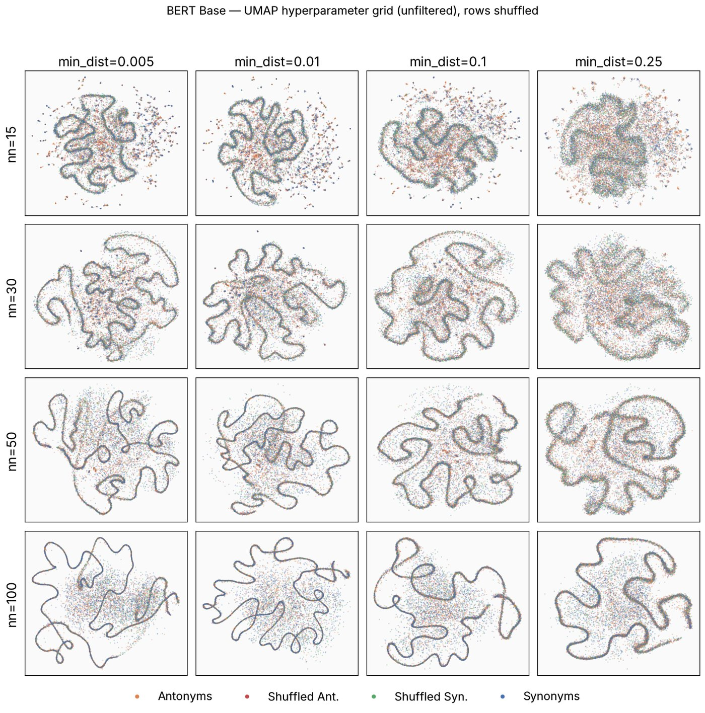
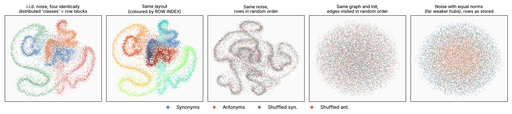
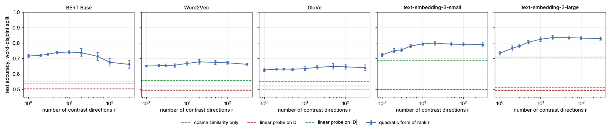

::: {.panel-tabset}

## Explore

The paper's figures are UMAP layouts of difference vectors $D = E(w_2) - E(w_1)$ for
antonym pairs, synonym pairs and two sets of randomly re-paired control pairs. Below,
the same vectors go through the same UMAP call; only the **order of the rows of the
data matrix** changes between layouts.

```{=html}
<div id="swirl-explorer"></div>
```

::: {.prose}

### Reading the panels

* **Main panel.** One point per word pair. UMAP settings are those of the paper's
  Figure 3 (`n_neighbors=30`, `min_dist=0.1`, Euclidean metric, `random_state=42`,
  umap-learn 0.5.11), except for the Adam layout.
* **Strip.** The order in which the rows were handed to UMAP, first row on the left,
  coloured by pair type. Four solid blocks for the paper's order; speckle for a shuffle.
* **Profile.** Each point's horizontal position in the plot against its position in
  that order. A clean curve means the plot coordinate is a function of *when the row
  was fed*.
* **Follows feed order.** Median distance in the feed order between neighbours in the
  plot, divided by its value for an unrelated ordering. 1 means the plot ignores the
  order; 0.02 means plot neighbours were fed one right after the other.
* **Same-type neighbours.** Share of each point's ten nearest plot neighbours with the
  same pair type. Chance is 0.25.

### What the tour shows

1. With the rows as stored, the four pair types form four coloured filaments. With the
   same rows shuffled, there is still a filament, and all four colours run along it
   together.
2. Coloured by row index, the stored layout is one smooth gradient: the filament *is*
   the row index.
3. Each shuffle draws its own curve, and each curve is a smooth gradient in *its own*
   feed order.
4. Sort the rows alphabetically, or by vector length, and the curve follows the
   alphabet, or the lengths.
5. Restack the four class blocks and the colours change places along the curve.
6. The layout is driven by a handful of pairs that are among the nearest neighbours of
   almost every other pair: *north/south*, *east/west*, spelling variants.
7. Random directions with the original vector lengths, in the stored row order, give
   four clean colours as well.
8. Layouts that cannot see the row order show no filament. In the OpenAI models part
   of the antonym and synonym mass still comes apart; that part is real, and the tab
   *What is real* quantifies it.

:::

## What went wrong

::: {.verdict}
**The swirl is an artefact of the layout optimiser, not a property of the embeddings.**
The filaments are parametrised by the row index of the data matrix, and the four pair
types separate because they are stored as four contiguous row blocks.
:::

### The curve is the row index

The paper's code stacks the pair types alphabetically (antonyms, shuffled antonyms,
shuffled synonyms, synonyms), standardises the difference vectors and calls
`umap.UMAP(metric="euclidean", random_state=42)`. For the shuffled pairs the row order
is the order in which `random.sample` happened to draw them, so it carries no
information about the embeddings. Yet two shuffled pairs that are neighbours in the
plot are a median of about 25 rows apart in text-embedding-3-large, 40 in BERT and
250–280 in word2vec, where 4,900–9,200 would be expected for an unrelated ordering.

| Model | rows | follows feed order: as stored | rows permuted | edges in random order | random directions, same lengths |
|---|---|---|---|---|---|
| Word2Vec | 30,406 | 0.028 | 0.027 | 0.92 | 0.002 |
| GloVe | 30,860 | 0.101 | 0.124 | 0.93 | 0.006 |
| BERT Base | 16,868 | 0.015 | 0.012 | 0.93 | 0.003 |
| text-embedding-3-small | 31,264 | 0.020 | 0.024 | 0.84 | 0.002 |
| text-embedding-3-large | 31,264 | 0.005 | 0.005 | 0.83 | 0.003 |
| i.i.d. noise | 16,000 | 0.016 | 0.015 | 1.00 | – |

: Rank-locality ratio with respect to the order in which the rows were given to UMAP.
1 means the plot ignores that order. {.striped}

| Model | same-type neighbours: as stored | rows permuted | edges in random order | random directions, same lengths |
|---|---|---|---|---|
| Word2Vec | 0.84 | 0.26 | 0.28 | 0.94 |
| GloVe | 0.74 | 0.26 | 0.28 | 0.95 |
| BERT Base | 0.86 | 0.27 | 0.29 | 0.98 |
| text-embedding-3-small | 0.87 | 0.29 | 0.31 | 0.95 |
| text-embedding-3-large | 0.89 | 0.29 | 0.32 | 0.96 |
| i.i.d. noise | 0.85 | 0.25 | 0.25 | – |

: Share of the ten nearest plot neighbours with the same pair type. Chance is 0.25. {.striped}

The control applied to the paper's Figure 2, the BERT hyperparameter grid: the filament
is there in all sixteen settings, with the four pair types mixed along it in every one.
Stability across `n_neighbors` and `min_dist` therefore does not distinguish structure
from artefact.

{width=70%}

### Mechanism: a sequential sweep over a hub-dominated graph

**It enters in the layout optimisation.** On BERT, with the rows permuted beforehand,
the spectral initialisation shows no relation to row order (ratio 1.00); the layout
after stochastic gradient descent does (0.01), for spectral, PCA and random
initialisation alike. Exact nearest neighbours instead of UMAP's approximate search
change nothing.

**It is the order in which edges are visited.** umap-learn stores the neighbour graph
as edge arrays sorted by head vertex and then tail vertex. With `random_state` set, the
0.5.x optimiser runs single-threaded and updates the edges in exactly that order,
moving both endpoints of each edge. Giving the *same* edges to the *same* optimiser in
a shuffled order removes the filament: the ratio returns to 0.83–0.93.

**It needs hubs.** In every model a handful of points appear in almost every
neighbour list.

| Model | dim | difference, Euclidean | difference, cosine | concatenation, Euclidean |
|---|---|---|---|---|
| Word2Vec | 300 | 76% (96%) | 3% (1%) | 40% (56%) |
| GloVe | 300 | 70% (60%) | 3% (1%) | 29% (33%) |
| BERT Base | 768 | 68% (95%) | 4% (2%) | 15% (16%) |
| text-embedding-3-small | 1536 | 70% (85%) | 4% (1%) | 4% (1%) |
| text-embedding-3-large | 3072 | 70% (96%) | 4% (1%) | 3% (1%) |

: Share of all neighbour slots of the exact 30-nearest-neighbour graph that point at
the 1% most popular points; in brackets, the share of all points that list the single
most popular point. An even graph would give 1%. {.striped}

A hub with an in-degree in the thousands receives thousands of attractive updates per
epoch, in ascending order of the row index of the other endpoint, and each update can
move it by several layout units. It therefore travels through the layout once per
epoch, and every other point, most of whose neighbours are hubs, is pulled towards
wherever the hubs are when its turn comes. Consecutive rows end up side by side; the
curve wiggles because points along it still repel each other.

The hubs are pairs whose two words have nearly the same embedding. In word2vec and
BERT they are compass directions: (north, south) is among the 30 nearest neighbours of
96% and 95% of *all* points, followed by (west, east), (northern, southern) and
(morning, afternoon). In GloVe they are (nothing, anything) and (upstairs,
downstairs); in the OpenAI models spelling variants such as (rabbinic, rabbinical),
(vandalise, vandalize) and (archaeological, archeological). Their difference vectors
are a fifth to a half as long as the median one, and 62–74% of the neighbour slots of
the shuffled pairs point at the top 1% of hubs. Colour the explorer by *Popularity as
a neighbour*, or search for *north*, to see them.

Why hubs form is standard high-dimensional geometry. Difference vectors are centred at
the origin and their lengths vary widely: related pairs give short vectors, random
pairs long ones. For unrelated $x$ and $y$ in high dimension,

$$\lVert x - y\rVert^2 \approx \lVert x\rVert^2 + \lVert y\rVert^2 ,$$

so the nearest neighbours of *every* point are the shortest vectors in the data set
[@radovanovic2010hubs; @hall2005geometric]. This accounts for each of the paper's
ablations:

| Observation in the paper | Reading |
|---|---|
| Swirl with the Euclidean metric, none with cosine | Cosine discards the length, and with it the hubs |
| Swirl with differences, none with concatenations (shown for BERT) | Concatenations are not centred at the origin with a wide spread of lengths: much weaker hubs for BERT, none for the OpenAI models |
| Crisper when the shuffled pairs are included | Shuffled pairs are long vectors without true neighbours, so nearly all their neighbours are hubs |
| Crispest for text-embedding-3-large | 3072 dimensions give the strongest distance concentration |
| Not in PCA or t-SNE | Neither uses an order-dependent sequential update |
| Stable across `n_neighbors` and `min_dist` | Neither changes the edge order or the hubs |

### A null model with nothing in it

Rows $x_i = s_i\, g_i$ with $g_i$ standard Gaussian in 300 dimensions and
$\log s_i \sim N(0, 0.25^2)$, all independent and identically distributed. The four
"pair types" are rows 1–4000, 4001–8000, and so on.



The layout is a swirl with four separated colours (same-type neighbours 0.85), and a
cluster-and-vote classifier "separates" the first block from the last with 91%
accuracy. Permuting rows or shuffling the edge order returns both numbers to chance.
With equal lengths the hubs weaken and the filament disappears.

### The transductive classifier reads the row order

The code behind the paper's Tables 3–4 is not in the repository, so this is a
reconstruction from the text: UMAP on all four pair types, drop the shuffled pairs,
k-means on the plot coordinates ($k = 20$), majority vote of the Stuttgart training
pairs per cluster, accuracy on the Stuttgart test pairs.

| Model | paper, UMAP + KMeans | reconstruction, rows as stored | rows permuted | edges in random order | random directions, same lengths | vote without UMAP |
|---|---|---|---|---|---|---|
| Word2Vec | 0.912 | 0.937 | 0.501 | 0.552 | 0.877 | 0.600 |
| GloVe | 0.857 | 0.892 | 0.523 | 0.560 | 0.878 | 0.569 |
| BERT Base | 0.917 | 0.904 | 0.511 | 0.553 | 0.977 | 0.633 |
| text-embedding-3-small | 0.933 | 0.952 | 0.650 | 0.701 | 0.804 | 0.713 |
| text-embedding-3-large | 0.936 | 0.870 | 0.619 | 0.692 | 0.955 | 0.709 |
| i.i.d. noise | – | 0.915 | 0.493 | 0.499 | – | – |

: Accuracy on the Stuttgart test pairs. {.striped}

With the rows as stored the reconstruction lands within a few points of the published
column. With permuted rows it is at chance for word2vec, GloVe and BERT and at
0.62–0.65 for the OpenAI models, below the same vote taken without any projection.
Vectors that contain nothing but each pair's length, in a random direction, score
0.80–0.98, although the length alone separates the classes with at most 0.53 accuracy.
The classifier recovers the row block a test pair was stored in. The lexical split
gives no protection, because the leak does not go through the words. If the original
experiments used any class-contiguous row order, as the loaders in this repository
produce, the UMAP columns of Tables 3–4 do not measure the embeddings.

### Library versions

All layouts in the explorer use umap-learn 0.5.11, the version in `uv.lock`, except
the Adam layout. umap-learn 0.6.0 keeps the same pipeline as its default
(`compatibility_layout`) and adds two optimisers, `optimizer="adam"` and `"momentum"`,
that shuffle the node order every epoch and buffer the updates.

| umap-learn 0.6.0 | data | follows feed order | same-type neighbours | transductive accuracy | same, rows permuted |
|---|---|---|---|---|---|
| default layout | i.i.d. noise | 0.016 | 0.85 | 0.90 | 0.51 |
| | BERT Base | 0.30 | 0.55 | 0.75 | 0.59 |
| | text-embedding-3-large | 0.10 | 0.71 | 0.90 | 0.64 |
| `optimizer="adam"` | i.i.d. noise | 0.99 | 0.25 | 0.50 | 0.49 |
| | BERT Base | 0.88 | 0.30 | 0.57 | 0.59 |
| | text-embedding-3-small | 0.79 | 0.34 | 0.73 | 0.73 |

With the default layout the artefact is still present, and on the noise null it is as
strong without a seed as with one. With Adam the layout no longer depends on the row
order, noise gives chance, and what remains for the real data (0.57 for BERT, 0.73 for
text-embedding-3-small) matches the edge-shuffled layouts and the vote taken without
a projection. That is the amount of antonym/synonym information the neighbour graph
holds.

### Claim by claim

| Claim in the paper | Status |
|---|---|
| "a consistent swirl in the UMAP projections of the difference vectors" | Reproduced with the pinned versions. It is the row order of the data matrix. |
| "This implies that this is not a simple projection artefact" | Does not follow: the artefact is stable across parametrisations too. |
| "each of the four datasets … seems to have a strong one-dimensional structure" | The one dimension is the row index. |
| "antonym points are quite separated from shuffled antonyms, and synonyms from shuffled synonyms" | They are separate row blocks. After permuting rows the agreement is at chance. |
| "stable across three very different types of embeddings … suggests … some structure at play" | All models share the row order and the length gap between related and random pairs. The latter is real, and is Figure 1 of the paper. |
| Tables 3–4, UMAP columns (0.72–0.97) | Reproduced by the row-order leak. |
| Tables 3–4, "Non-UMAP LR" ≈ 0.5 | What the symmetry of the relations predicts; see *What is real*. |
| Figure 5: PCA and t-SNE of text-embedding-3-large separate antonyms from synonyms | Sound. Neither method depends on row order. |

## What is real

::: {.keep}
Without any projection, and on word-disjoint splits, antonym and synonym pairs are
separated by a **low-dimensional second-order structure**. Its leading direction is an
evaluative polarity axis that agrees across all five models.
:::

Everything here is computed in the original space and does not depend on the order of
the rows (`scripts/08_projection_free_analysis.py`).

### Symmetry rules out first-order structure

Antonymy and synonymy are symmetric: $(a, b)$ and $(b, a)$ carry the same label, while
their difference vectors are $D$ and $-D$. Any odd function of $D$, in particular a
linear probe $w \cdot D + c$, therefore has the same expectation on both classes when
pair order is arbitrary. @todd2024function make the same point about function vectors
("cyclic tasks cannot be semantic vector offsets": $w + v = w'$ and $w' + v = w$ force
$v = 0$), and @ali2019antonym about translational embeddings. In the Stuttgart files
63% of the antonym pairs and 14% of the synonym pairs occur in both orders, so the
symmetry is partly built into the data.

Two consequences. The "Non-UMAP LR ≈ 0.5" column of the paper is what this symmetry
predicts, not a finding about embeddings. And the opening question, whether the one
differing semantic dimension is a Euclidean direction, cannot be put to first moments
at all. What can differ between the classes is an *even* function of $D$: its length,
or a quadratic form $D^\top A D$. An antonym pair determines a line, not a vector.

### How much of the task is the data set

The same word occurs in many pairs: 15,632 pairs over 9,405 words, 3.3 pairs per word
on average and up to 90. A "classifier" that never sees an embedding, and simply lets
the training pairs that share a word with the test pair vote, reaches **0.69** on the
Stuttgart split for every model, against 0.51–0.53 for cosine similarity. This is the
lexical memorisation effect of @levy-etal-2015-supervised, and the reason
@xie2021mixture introduced a word-disjoint split for this data set. The numbers below
are for word-disjoint splits (40% of the vocabulary held out, five random splits).

### A low-dimensional polarity structure

Take unit difference vectors $u = D / \lVert D\rVert$, form the second-moment matrices
$S_{\text{ant}}$ and $S_{\text{syn}}$ of antonym and synonym training pairs, and solve

$$S_{\text{ant}}\, v = \mu\, S_{\text{syn}}\, v .$$

Directions with $\mu \gg 1$ are those along which antonym pairs differ much more than
synonym pairs do. The rank-$r$ probe scores a pair by the zero-mean Gaussian
log-likelihood ratio restricted to the $r$ directions with the largest
$\lvert\log\mu\rvert$. It is the even counterpart of a linear probe.

| Model | cosine similarity | linear probe on $D$ | linear probe on $\lvert D\rvert$ | linear probe on $E_1 \circ E_2$ | quadratic, rank 1 | quadratic, best rank | leading $\mu$ |
|---|---|---|---|---|---|---|---|
| Word2Vec | 0.52 | 0.52 | 0.56 | 0.58 | 0.65 | 0.68 ($r = 20$) | 4.9 |
| GloVe | 0.52 | 0.50 | 0.55 | 0.58 | 0.63 | 0.65 ($r = 50$) | 3.9 |
| BERT Base | 0.54 | 0.51 | 0.55 | 0.58 | 0.72 | 0.74 ($r = 10$) | 6.7 |
| text-embedding-3-small | 0.50 | 0.51 | 0.69 | 0.74 | 0.72 | 0.80 ($r = 20$) | 8.4 |
| text-embedding-3-large | 0.51 | 0.51 | 0.71 | 0.74 | 0.73 | 0.84 ($r = 20$) | 9.9 |

: Test accuracy on word-disjoint splits, mean over five splits (standard deviations
at most 0.02). Chance is 0.5. {.striped}



* **One direction does much of the work.** Along the leading direction antonym pairs
  carry 4 to 10 times the energy of synonym pairs, and that direction alone classifies
  held-out pairs with 0.63–0.73 accuracy. For the static models and BERT further
  directions add at most three points; for the OpenAI models twenty directions add
  seven to ten.
* **It is interpretable.** Projecting single words onto the leading direction puts
  affirmative, positively evaluated words at one end and negated, deficient or failed
  ones at the other.

  | Model | one end of the leading direction | other end |
  |---|---|---|
  | Word2Vec | cooperation, equitable, prosperous, respectful, comfortable, durable | inaccurate, unprofessional, untrustworthy, unreliable, inadequate, unprepared |
  | GloVe | efficient, equitable, cooperative, achieve, enjoy, practical | inaccurate, unreliable, incomplete, inefficient, irresponsible, incompetent |
  | BERT Base | capable, practical, efficient, effective, awake, prosperous | false, absence, incorrect, lack, error, wrong |
  | text-embedding-3-small | advantageous, favourable, beneficial, convenient, legitimate, sufficient | unwillingness, unfit, ineffective, inaccurate, inability, ineligible |
  | text-embedding-3-large | respectable, supportive, conducive, prosperous, lawful, beneficial | unscientific, unsuitable, unworthy, unsuccessful, incompatible, unfit |

  In BERT and both OpenAI models the second direction contrasts decrease or withdrawal
  with increase or intensity (*diminish, demote, retire, withdraw* against *increase,
  expand, advance, huge*).
* **It is not only morphology.** Pairs in which one word is the other plus a negative
  prefix or suffix (*able/unable*, *careful/careless*) are 5–14% of the antonyms and
  score highest on the leading direction (AUC against synonyms 0.80–0.96). The other
  antonyms still score 0.63–0.76, and with every derived pair removed from training
  and test the rank-1 accuracy is unchanged.
* **It agrees across models.** The direction is fitted separately in each model. The
  coordinates it gives to words that occur in no training pair correlate between every
  pair of models: $\lvert\rho\rvert$ is 0.61–0.76 across model families and 0.87
  between the two OpenAI models (1,000–2,100 held-out words).

This is a testable version of what the paper's closing paragraph hopes for: a
structure shared by word2vec, GloVe, BERT input embeddings and the OpenAI models,
measured with a statistic that depends neither on a projection nor on row order.
There is no single antonymy direction for $D$, but antonym pairs differ along a small
set of shared polarity axes far more than synonym pairs do. The tab *Literature →
Antonym pairs as axes* shows that this is a replication, not a discovery.

### Reading the paper's Figure 5

The PCA of text-embedding-3-large difference vectors is a legitimate picture, and its
axes can be named. PC1 contrasts a common, short word with a rarer, more specific one
(*good* → *unfavourable*, *ready* → *unprepared*, but also the synonym pair *strong* →
*impregnable*); both classes spread along it. PC2 is the polarity axis above
(*competent* ↔ *incompetent*, *valuable* ↔ *worthless*); antonym pairs have twice the
spread of synonym pairs along it. Because the negated member of an antonym pair is
typically the rarer, derived word, the two axes are coupled for antonyms. That
produces the diagonal orange lobes, mirrored because both pair orders are present.

## Literature

The paper cites the antonym–synonym classifiers and the embedding-specialisation
methods. It does not cite the three literatures that study its central object, the
difference vector of a related word pair, nor the literature on what neighbour
embeddings can and cannot show. The sub-tabs go through them.

::: {.panel-tabset}

### Vector offsets

**The object has a name.** $E(w_2) - E(w_1)$ for a related pair is the *vector offset*
of the analogy literature, introduced with the claim that "each relationship is
characterized by a relation-specific vector offset" [@mikolov-etal-2013-linguistic].
What that literature found about lexical relations is the direct prior for any study
of antonym and synonym offsets.

**Offsets carry morphology, not lexicographic relations.** The Google analogy set that
accompanied word2vec [@mikolov2013efficient] has one "opposite" category. It consists
of 29 pairs, all negative-prefix derivations (un-, in-, im-, ir-, dis-, il-), and sits
among the *grammatical* categories; there are no lexical antonyms such as *hot/cold*.
@levy-goldberg-2014-linguistic, who showed that the offset method is a linear
combination of three pairwise similarities, report 37% accuracy on this category with
their improved objective and list "opposites" among the relations that "pose a
challenge" to both dense and explicit representations. BATS [@gladkova-etal-2016-analogy] made the test systematic: 40
relation types, among them synonyms by intensity and exact synonyms, gradable and
binary antonyms. With the offset method on their count-based model, accuracy is 4–19%
on the synonym categories and 9–33% on the antonym categories, depending on the
context window. Even the
classifier-assisted method of @drozd-etal-2016-word leaves lexicographic relations
under 20%. @koper2015multilingual, from the group that later built the Stuttgart data
set, constructed analogies from antonymy, synonymy and hypernymy pairs and concluded
that "continuous representations lack the ability to solve analogies of paradigmatic
relations".

**The closest methodological precedent.** @vylomova-etal-2016-take study difference
vectors for fifteen relations with much the same toolkit as the swirl paper: a t-SNE
plot of the difference vectors, spectral clustering, classifiers, random word pairs,
and "shuffled pairs" as negatives. Morphosyntactic relations cluster; lexical-semantic
ones largely do not. They exclude symmetric relations on purpose ("we excluded
symmetric lexical relations such as synonymy"), and they find that accuracy obtained
in a closed world collapses in an "open-world setting including random word pairs".

**Shuffled offsets as a control.** @fournier-etal-2020-analogies separate two
properties: whether the offsets of a relation point the same way, and whether they do
so more than offsets between *re-paired* words. Their control, "holding the start words
constant but permuting the end words", is the swirl paper's shuffled set. Two findings
matter here. For lexicographic relations (synonyms, antonyms, hypernyms and others
together) the pairing-consistency score is 0.51–0.55 across word2vec, GloVe, BERT and
GPT-2 token embeddings, where 0.5 is chance. And "offset concentration can exist even
when linguistic relations are, by construction, not coded": re-paired words from one
vocabulary still share structure, so they are not a structure-free null.

**Similarity confounds, and a warning about pictures.** @linzen-2016-issues shows that
the offset method "conflates offset consistency with largely irrelevant neighborhood
structure"; @rogers-etal-2017-many that it "suffers from dependence on vector
similarity". Both effects are at work in the swirl: the short difference vectors of
similar words dominate every neighbourhood. @schluter-2018-word raises "concerns
regarding the use of Principal Component Analysis to 2 or 3 dimensions as a provision
of visual evidence for the existence of word analogy relations in embeddings". The
concern applies with more force to a non-linear, stochastic projection.

**For the paper.** Introduce the difference vector as the offset of this literature;
state up front that offsets are known not to be parallel for antonymy and synonymy;
present the shuffled pairs as the control of @fournier-etal-2020-analogies and
@levy-etal-2015-supervised rather than as a new device.

### Memorisation and the benchmark

**Lexical memorisation.** @levy-etal-2015-supervised asked whether supervised
classifiers on concatenated or subtracted word vectors learn relations at all. Their
answer: they "do not actually learn a relation between two words. Instead, they learn
an independent property of a single word in the pair", which they named *lexical
memorization*. Two of their devices recur in the swirl paper without the reference.
They build train and test sets "with zero lexical overlap". And they test on
mismatched re-pairings of the positive pairs, the same construction as the shuffled
sets, finding that classifiers cannot tell true pairs from re-paired ones.
@weeds-etal-2014-learning and @roller-etal-2014-inclusive ran into the same problem
for hypernymy; the latter, notably, feed the classifier the difference *and the squared
difference*, an even function of $D$ of the kind the symmetry argument in *What is
real* calls for. @shwartz-etal-2016-improving named the remedy the "lexical split".

**The Stuttgart data set.** @nguyen2017distinguishing collected the pairs from WordNet
and Wordnik for a pattern-based model, balanced antonyms and synonyms one to one, and
split them at random into 70% train, 25% test and 5% validation. A random split of
pairs is exactly the setting in which memorisation pays. @xie2021mixture therefore
introduced a lexical split for this data and observed marked drops in F1. Three later
observations quantify the problem:

* ICE-NET [@ali-etal-2024-antonym], the unreferenced last row of the paper's Table 2,
  reports a baseline with *random* word vectors that reaches F1 0.66–0.80 on the
  random split. It is also a transductive method, built on a graph over the words of
  the data set, which matters for how Table 2 is compared with another transductive
  method.
* @todd2024function, who reuse the data, note that it "originally included multiple
  entries for a single input word".
* In this repository, letting the training pairs that share a word with a test pair
  vote, without any embedding, gives 0.69 on the Stuttgart split.

**Why antonyms look like synonyms to a distributional model.** Antonyms co-occur in
the same sentences far more often than chance, in preferred orders and within short
spans [@charles1989contexts; @justeson-katz-1991-co; @cao-etal-2025-distinctive],
which is one reason vectors built from contexts place them close together.
@mohammad-etal-2013-computing built a measure of lexical contrast on a related
"contrast hypothesis". The near-identical cosine distributions
in the paper's Figure 1 are the expected consequence, and the reason dedicated models
exist at all.

**For the paper.** Report every classification result on the lexical split first; add
the no-embedding word-overlap baseline and the random-vector baseline; cite
@levy-etal-2015-supervised for the concern that motivated the shuffled sets.

### Antonym pairs as axes

**Murphy's definition is an operating assumption elsewhere.** The paper paraphrases
@murphy2003semantic as: antonyms "agree on all contextual dimensions but one". A
sizeable literature *uses* the difference of an antonym pair as that one dimension.
@kim-de-marneffe-2013-deriving derive adjectival scales from the line through an
adjective and its antonym, reading off intermediate words along it.
@an-etal-2018-semaxis build 732 semantic axes from antonym pairs; POLAR
[@mathew2020polar] re-expresses whole embedding spaces in coordinates given by polar
opposites; @kozlowski2019geometry show that dimensions such as *rich − poor*
correspond to dimensions of cultural meaning such as class; @grand2022semantic recover human
feature ratings by projecting words onto such lines. @bolukbasi2016man, which the
paper does cite, is the best-known member of the family. In all of these each pair, or
each small group of pairs, has its own axis. That is hypothesis (b) of
@xie2021mixture, which the paper quotes.

**The axes are few.** If every antonym pair had an unrelated axis, nothing would be
shared between pairs. That is not what is found. @kozlowski2025semantic report that
projections of words on antonym-pair directions in the embedding matrices of large
language models "effectively reduce to a 3-dimensional subspace … closely resembling
the patterns derived from human survey responses". @rothe-etal-2016-ultradense
concentrate sentiment into an "ultradense" subspace by an orthogonal transformation of
a static embedding. @hollinsworth-etal-2024-language find a single linear sentiment
direction in language models, and note that negation flips it. Going the other way,
@yih-etal-2012-polarity built a latent space in which synonyms have cosine near one
and antonyms near minus one, by making polarity an explicit sign.

**The linguistic side.** @koptjevskaja2024cross distinguish lexical antonyms
(*true/false*) from derived ones (*true/untrue*) across 55 languages. Derived forms
target the member that is lower in valence or magnitude, and core property concepts
tend to have lexical antonyms. This is the markedness asymmetry that couples the
polarity axis with the frequency axis in the paper's own PCA figure.

**Where the projection-free result sits.** The second-moment analysis in *What is
real* finds, for all five models, a leading direction with affirmative words at one end
and negated or deficient ones at the other, a second direction of decrease against
increase, and agreement between models on held-out words. That is this literature's
picture, reproduced on the Stuttgart pairs with a statistic that respects the symmetry
of the relation. It should be presented as such.

### Relations inside language models

**Linear representations and the choice of inner product.** @park2024linear formalise
the linear representation hypothesis and estimate concept directions from differences
of counterfactual word pairs, among them `adj ⇒ un+adj` and `small ⇒ big`. They test
the directions against 100,000 random word pairs. They also argue that "there is no
obvious reason to expect that algebraic manipulations based on, e.g., the Euclidean
inner product, should be semantically meaningful", and propose an inner product
whitened by the covariance of the unembedding vectors. For the swirl paper this bears
on two choices that are made without comment: per-coordinate standardisation, and
Euclidean against cosine distance. The second decides whether the hubs exist.

**Antonymy as a function, not an offset.** "Antonym" is the lead task of function
vectors [@todd2024function], whose antonym and synonym tasks are built from the
Stuttgart data. The same paper contains the symmetry argument in one line: an
involution cannot be a constant offset. @hernandez2024linearity include "adjective
antonym" among 47 relations tested for linear decodability from subject
representations. @lindsey2025biology describe language-independent antonym and synonym
features in a production model that act as function vectors of this kind. Taken
together, these suggest that where models encode antonymy it is as an operation
applied to a word, which is not something a cloud of difference vectors in the input
embedding can display.

**Probing work on exactly these relations.** @diera2026language probe synonymy,
antonymy, hypernymy and hyponymy in three language models with lemma-disjoint splits
and random-pair controls, and find antonymy the easiest relation and synonymy the
hardest. @cao2026relation look for relation geometry in three language models and a
static baseline; they find none for synonymy, and on antonymy the static baseline is
ahead of the language models. @cao2025comprehensive compare six models with human
judgements and single out antonymy as the relation all models handle reasonably well.
These are the natural comparison points for any claim about antonym geometry in BERT
or in the OpenAI embeddings, and none of them relies on a projection.

**How non-linear structure is established.** @engels2025not show that some features
are irreducibly multi-dimensional, circles for weekdays and months. The claim rests on
a formal definition of what counts as an irreducible feature and on intervention
experiments. It is a useful template for the standard of evidence a "curved structure"
claim needs.

**Universality.** The paper closes by pointing to shared structure across models
[@huh2024platonic; @jha2025harnessing]. The cross-model stability of the swirl cannot
support that, because row order and hubness are shared by construction. The
agreement of the polarity direction on held-out words (rank correlation 0.61–0.76
between model families) can, in a modest way.

### Neighbour embeddings

**UMAP's own caveats.** The UMAP paper [@mcinnes2018umap] lists among its weaknesses
that the method "can tend to find manifold structure within the noise of a dataset –
similar to the way the human mind finds structured constellations among the stars",
and that detecting a spurious embedding "is a topic of further research". For the
GoogleNews word vectors the authors themselves used cosine distance.

**Over-contraction.** @damrich2021umap derive the loss that UMAP's sampling scheme
actually optimises and show that it differs from the stated one. Two consequences are
relevant. The layout depends on little beyond the binary neighbour graph. And UMAP
contracts: a ring sampled uniformly in the plane, embedded from two dimensions into
two, comes out with its width contracted "nearly to a line", more so when the ring is
part of a larger data set. Thin curves are a default output of the method.
@bohm2022attraction place UMAP on a spectrum between attraction and repulsion, at
about the position of t-SNE with exaggeration 4. Stronger attraction favours
continuous, connected shapes and costs local accuracy. "Not visible in t-SNE" is then
a statement about one point of that spectrum. @kobak2021initialization show how much
of the global shape of either method is inherited from the initialisation, which is
why the stage-by-stage test in *What went wrong* matters.

**Misreading nested scales.** @wattenberg2016tsne embed two Gaussians with a common
centre, one fifty times tighter than the other, from 50 dimensions: "the outer group
becomes a circle … it would be easy to misread these outer points as a one-dimensional
structure". Short related-pair vectors inside long random-pair vectors are this
configuration.

**What a plot can support.** @chari2023specious argue that two-dimensional embeddings
distort so much that they can be made to show anything; @lause2024elephant reply that
embeddings should be judged by neighbourhood measures such as kNN recall, that is, by
whether structure in the plot corresponds to something measurable in the
high-dimensional neighbour graph. The swirl fails that test. The consensus
recommendations of @debodt2025lowdim include: "Investigate unusual shapes or patterns
… unusually elongated shapes can be the result of erroneously including sample numbers
as a spurious feature", and "A 2D or 3D embedding should not be used to support
definitive scientific statements about the data". Here the sample number enters
through the optimiser, not as a feature. @jeon2025stop review 136 papers and trace
most misuse to reading relationships off projections.

**Null models.** Checking a plot against data with the structure removed is routine
in single-cell work: EMBEDR resamples each feature independently and assigns
per-point significance [@johnson2022embedr]; scDEED permutes features across cells
and flags points whose neighbours do not survive [@xia2024scdeed]; @liu2025loomap
give point-wise diagnostics for spurious local structure. The controls in this
repository are of the same kind, with two nulls tailored to the question:
length-matched random directions, and i.i.d. noise.

**What upstream knows.** umap-learn issue 840, open since 2022, reports
label-ordered structure on nearly identical random rows that disappears when the rows
are shuffled; the maintainers attribute it to ties in the neighbour search. In issue
250 an odd plot is traced to an index column left in the data, and a later comment
asks what "worm"-like artefacts mean when there is no such column. Neither thread
mentions the visiting order of edges in the layout optimiser, and the literature
search for this review found no description of the mechanism shown here. That is weak
evidence of novelty, but the mechanism may be worth reporting upstream. umap-learn
0.6's new optimisers remove it.

### Hubness and distance concentration

**Hubs.** @radovanovic2010hubs showed that in high dimension the number of times a
point occurs among the nearest neighbours of others becomes strongly skewed, and that
"points closer to the mean tend to become hubs". For difference vectors the mean is
the origin, so "closer to the mean" means "short". They also note an exception that
matches the paper's cosine ablation: with cosine distance on such data "no vector is
more spatially central than any other".

**A theorem for the two-scale case.** @hall2005geometric study two populations with
equal means and different scales as the dimension grows. Within-sample distances
concentrate at $\sqrt2\,\sigma$ and $\sqrt2\,\tau$, cross-sample distances at
$\sqrt{\sigma^2 + \tau^2}$, and their Theorem 3 says that a nearest-neighbour rule
then assigns points of *both* populations to the one with the smaller scale. Short
related-pair vectors and long shuffled-pair vectors are such a pair of populations.
This is the statement $\lVert x - y\rVert^2 \approx \lVert x\rVert^2 +
\lVert y\rVert^2$ made precise, and it is why 62–74% of the neighbours of the
shuffled pairs are hubs. @beyer1999nearest is the classical reference for the
underlying concentration of distances.

**In word-vector spaces.** @dinu2015hubness document that neighbourhoods of word
vectors "are strongly polluted by hubs"; @feldbauer2019hubness compare methods that
reduce hubness and find scaling methods reliable. The documentation of umap-learn
itself, following @dalmia2021clustering, warns that the neighbour graph is
"susceptible to … the hub effect, where certain points become highly influential when
highly connected", and offers a mutual-neighbour graph as a remedy.
@bratic2018nndescent study NN-descent, the approximate neighbour search that UMAP
uses, on high-dimensional data; in the present case exact neighbours give the same
picture.

**Lengths and coordinates in embedding spaces.** Vector length is not neutral in
static embeddings: together with term frequency it measures a word's "significance"
[@schakel2015measuring], and the leading principal directions encode frequency
[@mu2018allbutthetop]. In contextual models a few "rogue" coordinates dominate
distances unless the data are standardised [@timkey-van-schijndel-2021-bark]. The
length of a difference vector mixes all of this with the similarity of the two words.
A method that is sensitive to length, as Euclidean neighbour search is, will pick it
up first.

**For the paper.** Report a hubness statistic for any neighbour graph that is
visualised; justify the metric; and treat "Euclidean yes, cosine no" as a diagnosis
rather than as a curiosity.

### Housekeeping

In `prose/antonyms_bib.bib`:

* `Nguyen2017AntSynNET` and `nguyen2017distinguishing` are the same EACL 2017 paper.
  The first has wrong pages; the Anthology record says 76–85. Both keys are cited.
* `Ali2019Distiller` (arXiv) and `ali2019antonym` (AAAI) are the same paper.
* ICE-NET appears in Table 2 without a reference: Ali, Hu, Qin and Wang, Findings of
  EACL 2024 [@ali-etal-2024-antonym].
* `koptjevskaja2024cross`: DOI 10.1515/ling-2023-0140.

`analysis/suggested_references.bib` holds the entries used in this document that are
not yet in the paper's bibliography.

:::

## For the paper

### What cannot stand

1. The swirl as evidence of structure in the embeddings, and the sentence "Is this
   swirl just a projection artefact … ? We argue not".
2. The UMAP columns of Tables 3–4, unless they are re-run with the row order
   randomised and still hold.
3. Cross-model stability as an argument, in the form given.

### Two ways forward

**A methods note about the artefact.** A seeded UMAP that draws the row order of its
input as a smooth curve, turns storage order into apparent class structure, and yields
90% "transductive accuracy" on noise is a clean cautionary example. The mechanism,
a sequential edge sweep over a hub-dominated graph, does not seem to be documented.
The existing figures, the controls and the noise null are most of such a note, and the
title "A visual observation…" would still fit.

**A paper about antonymy.** The projection-free result is the candidate: symmetry
rules out first-order structure; second-order structure exists, is low-dimensional,
interpretable and shared across models. It should be framed as a replication on the
Stuttgart pairs of the semantic-axes literature, evaluated on word-disjoint splits.

The two can be combined: the first as the cautionary half, the second as what a
sound analysis of the same data shows.

### A checklist for neighbour-embedding figures

* Shuffle the rows before fitting, and colour the result by row index once.
* Use an optimiser that does not depend on row order (umap-learn ≥ 0.6 with
  `optimizer="adam"`). Dropping the seed is not enough.
* Report a hubness statistic for the neighbour graph and justify the metric.
* Add a null panel: random directions with the original lengths, in the same row
  order.
* State library versions. The same call gives different pictures in 0.5.11 and 0.6.0.
* Do not train anything on plot coordinates without the controls above.

### Related work to add

The three literatures that study the same object are missing: vector offsets, lexical
memorisation, and antonym pairs as semantic axes. The *Literature* tab gives a
paragraph-level account of each and says what to take from it.

## Reproduce

```bash
uv sync --extra dev                       # pins umap-learn 0.5.11, as used for the paper figures
python scripts/02_extract_embeddings.py   # BERT, word2vec (and GloVe if installed)

python scripts/07_row_order_controls.py          # controls and nulls   -> results/row_order_controls/
python scripts/08_projection_free_analysis.py    # probes, second moments -> results/projection_free/
python scripts/09_build_explorer.py              # layouts for this page -> analysis/explorer/explorer_data.js
quarto render analysis/explorer/swirl_explorer.qmd

# optional, in an environment with umap-learn 0.6: the Adam layouts
python scripts/07_row_order_controls.py --umap-optimizer adam \
    --out-dir results/row_order_controls_umap060_adam
```

The page is a single HTML file with no external requests: the explorer is plain
JavaScript on canvas, and the layouts are embedded as base64 arrays.

### Limits

* The classification result is a reconstruction; the original code for Tables 3–4 is
  not in the repository, and its row order is inferred from the loaders.
* Layouts were computed on Linux with one UMAP seed (42, the paper's). The published
  figures come from another platform and differ in detail, not in kind.
* The mechanism is established by intervention on edge order, row order and vector
  lengths, not by a formal analysis of the optimiser.
* The projection-free analysis uses one data set, one language and type-level
  embeddings. Its settings were fixed after a brief look at BERT and not tuned per
  model.
* The stage-by-stage test of the optimiser and the reading of the principal components
  were done once by hand and are not scripted.

### About this page

Written by an AI coding assistant (Claude) at the author's request, as a referee-style
review of the preprint. Every layout shown was computed by the scripts in the
repository. The literature entries were checked against publisher records, but they
should be re-checked before they are cited. The text of the preprint itself was not
changed.

## References

::: {#refs}
:::

:::
